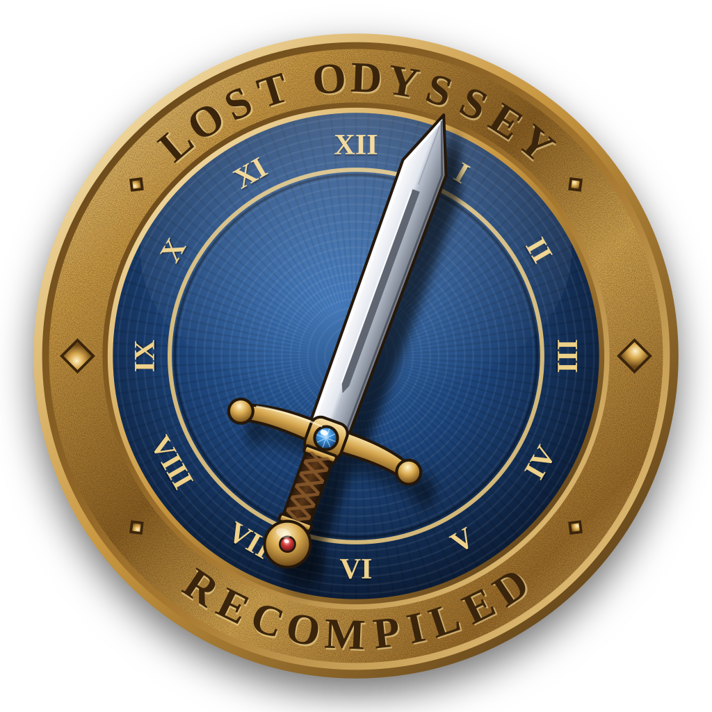
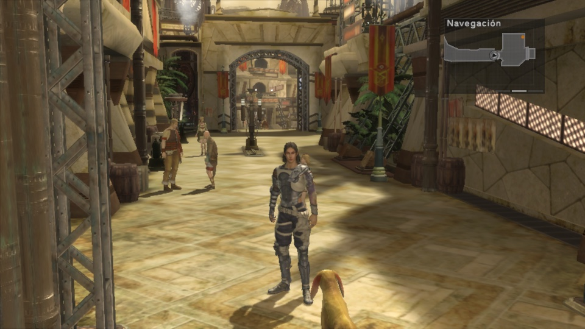
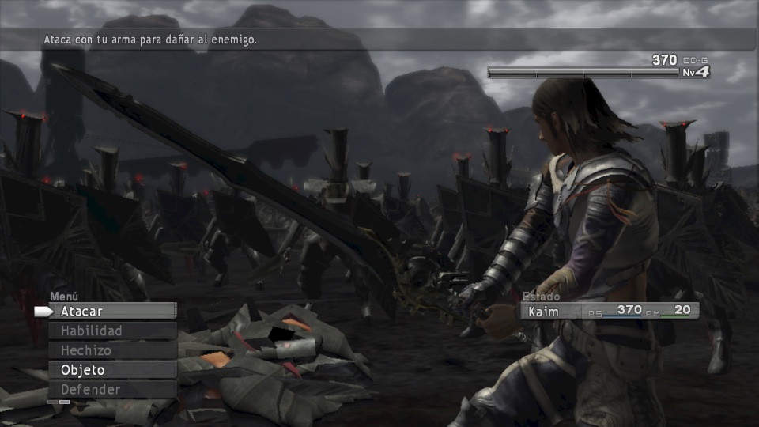
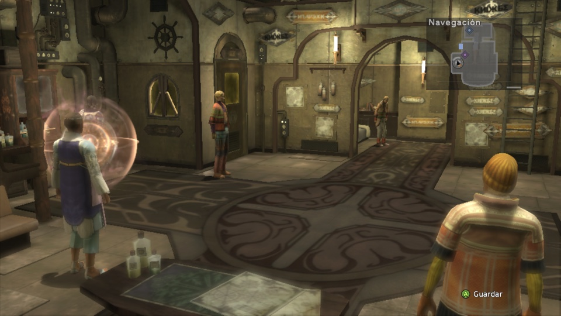

# Lost Odyssey Recomp for Nintendo Switch

**Lost Odyssey (Xbox 360), recompiled to run natively on the Nintendo Switch.**

### [Download](https://github.com/Ad0ky/LostOdysseyRecomp/releases) · [Installation guide](docs/INSTALL-SWITCH.md) · [Report a problem](https://github.com/Ad0ky/LostOdysseyRecomp/issues) · [Discord](https://discord.gg/z2yPct6z2w)

By **Ad0ky** and **depende3000**, based on [freefrank's Lost Odyssey Recomp](https://github.com/freefrank/LostOdysseyRecomp).
Free and open source: if you paid for this, ask for a refund.

## What this is

A homebrew build of Lost Odyssey Recomp for Switch consoles running custom firmware (Atmosphère). The game's Xbox 360 code is statically recompiled to native ARM64, and its graphics run on **deko3d**, the Switch's own graphics API. It plays at the Switch's stock clocks.

You need your own Lost Odyssey discs. This project contains no game files.

> **Experimental.** The whole game is playable, but expect rough edges: report crashes, missing effects or anything that looks or sounds different from the Xbox 360 ([how](#reporting-a-problem)).

## Performance

The game is fully playable at the Switch's **stock clocks** (CPU 1020 MHz, GPU 460 MHz), measured in handheld mode at 960×540:

| Scene | Frame rate at stock clocks |
| :--- | ---: |
| Merchant ship and lighter areas | **30 FPS**, the game's cap |
| Crowded battles | **24–28 FPS** at 960×540, **30 FPS** at 640×360 |
| Busiest streets | **27 FPS** |

**For a perfect, locked 30 FPS everywhere, we recommend a light overclock (for example with sys-clk).** Stay within what your console and cooling can handle. Without one the game is still fully playable.

[docs/SWITCH-BENCHMARKS.md](docs/SWITCH-BENCHMARKS.md) shows how it was measured.

## Getting started

You need:

- a Switch with **Atmosphère** and the Homebrew Menu;
- a **microSD card (exFAT)** with about **25 GB** free;
- your **Lost Odyssey discs** (Asian multilingual or USA/Europe edition, as ISOs, Games on Demand data or folders);
- a **Windows or Linux PC**, to extract the discs once with the [PC version](https://github.com/freefrank/LostOdysseyRecomp/releases/latest).

Then:

1. **Extract your discs** with the PC version's importer. It leaves a `game` folder with `disc1`–`disc4`.
2. **Copy the release ZIP** to `sdmc:/switch/LostOdysseyRecomp/`, and the disc folders into its `game/`.
3. **Start the Homebrew Menu through title takeover:** hold **R** while starting any installed game, then choose **Lost Odyssey Recomp**. Starting from the Album doesn't work, because the game needs the full application memory.

The [installation guide](docs/INSTALL-SWITCH.md) has every step, the SD card layout and how to update.

## Settings

On the title screen, **Y** opens **Settings**. Settings are saved in `settings.ini`.

### Graphics

| Option | What it does |
| :--- | :--- |
| **Graphics preset** | Sets the options below in one step. All three presets use FSR and 30 FPS. **Balanced (recommended)** is the default: dynamic resolution 360–540p, depth of field at 50%, no bloom, dynamic shadows and motion blur on. **Quality** renders a fixed 540p with every effect. **Performance** is Balanced without dynamic shadows, motion blur or depth of field. Changing any option below shows **Custom**. |
| **Render resolution** | The height the 3D scene is rendered at before it's scaled to the screen, from 360p to 720p, set separately for handheld and docked. Automatic is 540p. With dynamic resolution on, this row is called **Maximum resolution**. |
| **Dynamic resolution** | Lowers the scene's resolution step by step when the GPU can't finish a frame in time, and raises it again when there's room, so the frame rate holds steadier. |
| **Minimum resolution** | How low dynamic resolution may go. Shown when dynamic resolution is on. |
| **FSR** | AMD FSR 1: scales the scene to the screen with sharper edges than plain scaling. Costs a little GPU time. |
| **FSR sharpness** | How strongly FSR sharpens: 0% is no sharpening, 100% the strongest. |
| **Dynamic shadows** | Character and object shadows. **Low** keeps only the largest ones; **Off** removes them. Both raise the frame rate. |
| **Depth of field** | Strength of the game's background blur. 100% is the original look; **Off** keeps distant scenery sharp. |
| **Bloom** | The game's glow around bright areas. Off removes it, and the picture gets slightly darker. |
| **Motion blur** | The blur during fast camera and character movement. Off keeps moving scenes sharp. |
| **Culling** | How soon objects at the screen edges stop being drawn. 100% is the original; lower costs frame rate, higher hides them sooner. |
| **Scaling filter** | The filter used when the scene is scaled without FSR: **Standard** (bilinear) or **High** (bicubic, slower on the Switch). |
| **Frame rate** | The game's frame rate target. Lost Odyssey runs at 30 FPS, and the presets use that. |
| **Loading speed** | **Original** keeps the Xbox 360's loading pace; **Fast** loads quicker. Effects play at normal speed either way. |
| **Performance overlay** | Off by default. **FPS** shows the frame rate; **Detailed** adds a bar with the render resolution, FSR, and the CPU and GPU load. |
| **Brightness** | Opens a page to adjust brightness and gamma. |

### Other settings

Text, the HUD and the menus follow the console's language, Spanish included.

`env.txt`, next to the game, holds settings that aren't in the menu. A line there wins over the matching menu option, which then shows greyed out. The [installation guide](docs/INSTALL-SWITCH.md#settings) explains the release's `env.txt`.

**LB+RB** opens the debug menu: Save Anywhere, teleport, fast-forward, encounter rate and cheats.

## Screenshots

| First battle | Merchant ship |
| :---: | :---: |
|  |  |

All screenshots were taken on a Switch in handheld mode at 960×540.

## Reporting a problem

[Open an issue](https://github.com/Ad0ky/LostOdysseyRecomp/issues) with:

- the release version;
- your game edition;
- handheld or docked;
- your `env.txt`;
- what was on screen when it happened.

Also attach the files the game writes in `sdmc:/switch/LostOdysseyRecomp/`: `state/logs/runtime-*.log`, `stderr.log` and, if they exist, `crash.log`, `hang.log` and `exit.log`.

For a problem while playing, also zip the `save/` folder (your saves) and say which slot it happens on. Don't attach the game's disc files (`game/`).

Questions and help: the [Discord](https://discord.gg/z2yPct6z2w).

## For developers

- [docs/SWITCH.md](docs/SWITCH.md): building the Switch version, how the port works, the deko3d back end, logs and diagnostics.
- **Debug server and benchmarks:** `tools/switch/lo_debug.py` deploys builds and reads logs, screenshots and input over the local network. `tools/switch/bench.py` runs scripted benchmarks hands-free.
- [docs/SWITCH-PGO.md](docs/SWITCH-PGO.md): the profile-guided build.
- [docs/SWITCH-BENCHMARKS.md](docs/SWITCH-BENCHMARKS.md): every optimization, with its numbers.

This repository also carries the rest of upstream's source, so the PC, macOS and Android versions still build from it. For those, use [freefrank/LostOdysseyRecomp](https://github.com/freefrank/LostOdysseyRecomp).

## Credits

- **Switch port:** [Ad0ky](https://github.com/Ad0ky) and [depende3000](https://github.com/depende3000).
- **Lost Odyssey Recomp:** [freefrank](https://github.com/freefrank) and its contributors: [MikeRavenelle](https://github.com/MikeRavenelle), [dj5927](https://github.com/dj5927), [Xarishark](https://github.com/Xarishark), [navjack](https://github.com/navjack), [frankzzz](https://github.com/frankzzz), [cngjd](https://github.com/cngjd) and [faisalkindi](https://github.com/faisalkindi).
- **Research and tools:**
  - [UnleashedRecomp](https://github.com/hedge-dev/UnleashedRecomp), [XenonRecomp](https://github.com/hedge-dev/XenonRecomp), [XenosRecomp](https://github.com/hedge-dev/XenosRecomp), [re:Blue](https://github.com/zolaware/reblue), [plume](https://github.com/renderbag/plume) and [Xenia](https://github.com/xenia-project/xenia);
  - on the Switch: [devkitPro](https://devkitpro.org), [libnx](https://github.com/switchbrew/libnx), [deko3d](https://github.com/devkitPro/deko3d) and [Atmosphère](https://github.com/Atmosphere-NX/Atmosphere).
- **Upscaling:** thanks to AMD for [FidelityFX Super Resolution 1](https://github.com/GPUOpen-Effects/FidelityFX-FSR) (MIT), the FSR option on the Switch. Its shader port follows the deko3d one in [SwitchWakerHD](https://github.com/centollOS/SwitchWakerHD), whose debug server the Switch build's also follows.
- **Audio** uses the [Xenia FFmpeg fork](https://github.com/xenia-project/FFmpeg) ([license](thirdparty/ffmpeg-LICENSE.txt)).

Lost Odyssey and its assets belong to their respective owners. This is an unofficial, non-commercial project under the GPL-3.0; dependencies keep their own licenses. Use data from discs you own, and don't commit game executables, archives, textures, audio, video, generated game code or captures to this repository.
