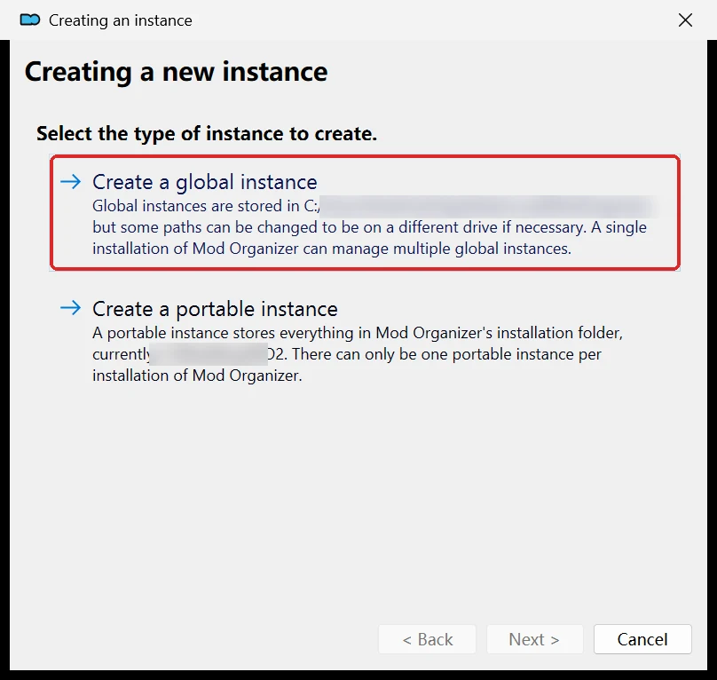
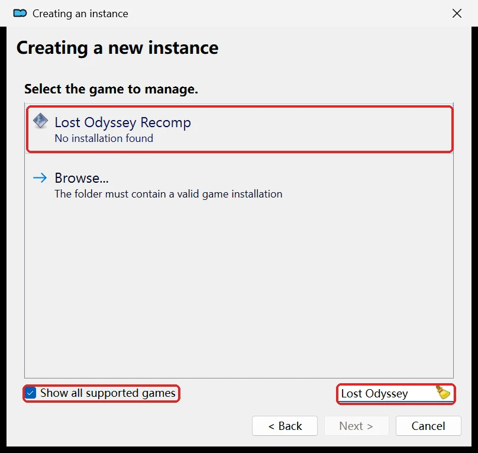
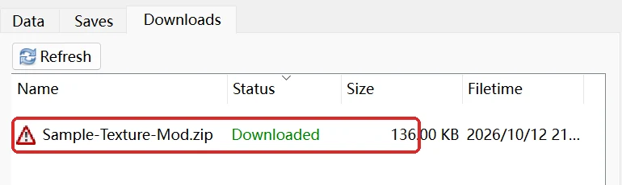
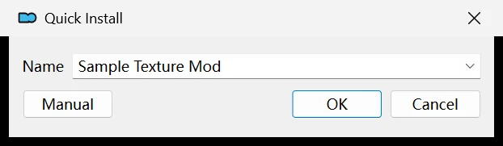
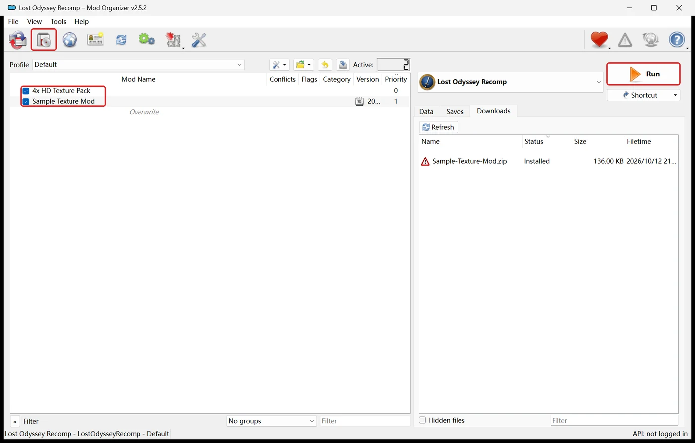
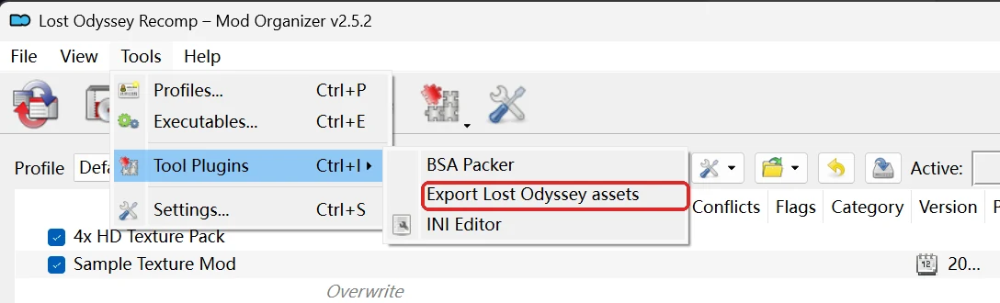
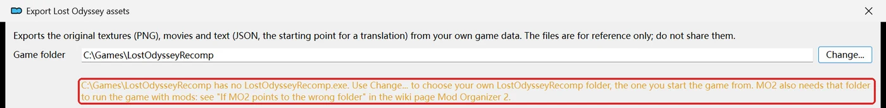
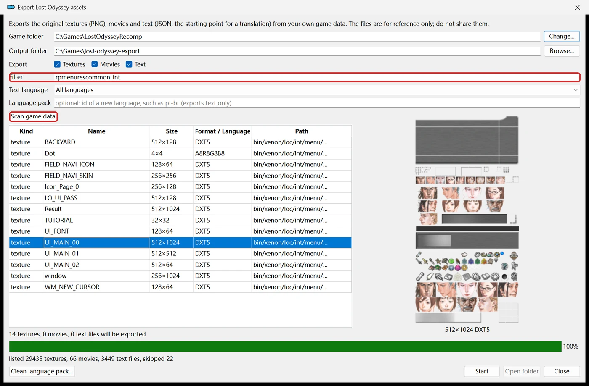
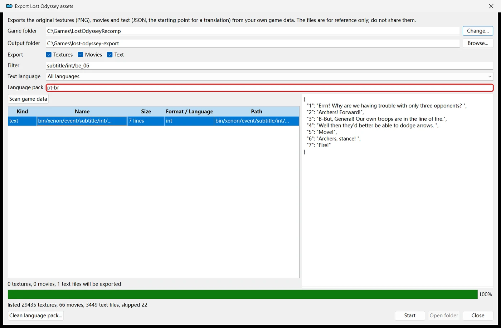

# Mod Organizer 2

LostOdysseyRecomp has a Mod Organizer 2 (MO2) game plugin. MO2 maps the mods you enable onto the game's `mods/` folder through its virtual file system, so nothing is copied into the game folder and disabling a mod removes it on the next launch. MO2 runs the Windows build only.

## Before you start

- MO2 2.5 or newer on Windows. It already includes the `basic_games` plugin.
- The game is set up: you started it once and finished the first-start setup that imports your discs.
- You know your LostOdysseyRecomp folder: the folder you start the game from, which holds `LostOdysseyRecomp.exe` (the extracted Windows ZIP). In this guide it is `C:\Games\LostOdysseyRecomp`; yours can be anywhere.

## 1. Install the plugins (once)

1. Open [game_lostodysseyrecomp.py](https://github.com/freefrank/LostOdysseyRecomp/blob/main/tools/modding/mo2/game_lostodysseyrecomp.py), press **Download raw file** (the download icon above the code) and put the file in `<MO2 folder>\plugins\basic_games\games\`.
2. Optional, for exporting the game's textures, movies and text: download [lostodysseyrecomp_export.py](https://github.com/freefrank/LostOdysseyRecomp/blob/main/tools/modding/mo2/lostodysseyrecomp_export.py) the same way and put it in `<MO2 folder>\plugins\`. Not in `plugins\basic_games\`.
3. Restart MO2 if it is running.

Download the files again when a new game version comes out; MO2 loads them when it starts.

## 2. Create an instance for the game

1. Start MO2. If it does not open the instance window by itself, click the first toolbar button (**Manage Instances**) and press **Create new instance**.
2. Choose **Create a global instance**.

   

3. On **Select the game to manage**, tick **Show all supported games** and type `Lost Odyssey` in the box next to it. Click **Lost Odyssey Recomp**. "No installation found" is normal: MO2 cannot find the game by itself.

   

4. A folder window opens. Go to your LostOdysseyRecomp folder, the one with `LostOdysseyRecomp.exe`, and press **Select Folder**. Look at the folder before you press it: the window starts in the last folder you used, which may be someone else's example or an older install.
5. **Customize the name**: keep it or type your own, then press **Next**. Press **Next** on the profile settings page too.
6. **Select a folder where the data should be stored**: keep the default and press **Next**. Never choose your game folder here: MO2 would keep its own `mods`, `downloads` and `profiles` folders in it, and its `mods` would be the same folder the game reads mods from.
7. Press **Next** on the Nexus page (optional), check that the game location on the last page is your LostOdysseyRecomp folder, and press **Finish**.

## 3. Install a mod

1. Click the second toolbar button (**Install Mod**) and choose the mod's archive (`.zip`, `.7z` or `.rar`). You can also drag the archive onto MO2's window: it then appears on the **Downloads** tab, and double-clicking it there installs it.

   

2. MO2 shows **Quick Install** with a name for the mod. Change the name if you like and press **OK**.

   

3. The mod appears in the left list. Tick its box to enable it.

What installs as is: mod folders (`mods/<id>/mod.ini` with `mods/<id>/overlay/...` or `mods/<id>/overlay.loarc`), older `mod.ini` packages, overlay packages (a top-level `overlay/` folder) and language packs (a folder with a `language.ini`). The plugin removes the outer `mods/` folder of those archives, so their contents land in the game's `mods/`. An archive whose top holds `mod.ini` or `language.ini` itself (the inside of such a folder) is marked as invalid: put it in a folder named after the mod in MO2's manual installer. Download the game plugin again if MO2 says a mod folder or language pack has no valid game data.

## 4. Play

1. Check that **Lost Odyssey Recomp** is selected in the list next to **Run**.
2. Press **Run**. Always start the game this way; starting `LostOdysseyRecomp.exe` directly loads no MO2 mods.
3. After you enable, disable or reorder mods, close the game and press **Run** again.



## If MO2 points to the wrong folder

MO2 keeps an instance's game folder in the instance's `ModOrganizer.ini`. The export tool warns about it (see [Export the original assets](#export-the-original-assets)), and the game does not see your MO2 mods. To point an existing instance at your LostOdysseyRecomp folder:

1. Close MO2.
2. Open the instance's `ModOrganizer.ini` in a text editor. A global instance keeps it in `%LOCALAPPDATA%\ModOrganizer\<instance name>\` (paste that path into the File Explorer address bar, with your instance's name). A portable instance keeps it in the MO2 folder itself.
3. Under `[General]`, change the `gamePath` line to your folder, writing every `\` twice. For `D:\Games\LostOdysseyRecomp`:

   ```ini
   gamePath=@ByteArray(D:\\Games\\LostOdysseyRecomp)
   ```

4. Save the file and start MO2.

Creating a new instance for the right folder ([step 2](#2-create-an-instance-for-the-game)) works too; install your mods into it again.

If the data folder of an instance is your game folder (step 2.6), create a new instance with the default data folder, then delete the `downloads`, `overwrite`, `profiles` and `webcache` folders MO2 made in your game folder. Keep the game's own `mods` folder.

## Export the original assets

The export tool copies the game's own textures, movies, text, 3D models and animations out of your game data. Use them as the starting point for a mod: textures to repaint or upscale, text to translate. Models and animations are for reference only. It needs `lostodysseyrecomp_export.py` from [step 1](#1-install-the-plugins-once).

### Open the tool

In the menu bar, choose **Tools > Tool Plugins > Export Lost Odyssey assets**.



### Export

1. Check the window:
   - **Game folder**: the folder the tool reads, normally MO2's game folder. If the window says it has no `LostOdysseyRecomp.exe`, press **Change...** and choose the folder you start the game from. The tool remembers it. This changes only the export tool: to play with mods, fix MO2's folder as in [If MO2 points to the wrong folder](#if-mo2-points-to-the-wrong-folder).

     

   - **Output folder**: where the files go. The default is a new `lost-odyssey-export` folder in your MO2 instance folder. It must be a new or empty folder, outside the game folder. A full export needs about 7 GB of free space, and models and animations need about 6.5 GB more.
   - **Export**: tick what you need.
     - **Textures**: every texture as a PNG image (about 5.3 GB).
     - **Movies**: the CG movies as the original WMV files (about 1.7 GB).
     - **Text**: all game text as JSON files, for translations (about 33 MB).
     - **Models**: every 3D model as a glTF `.glb` file (about 4 GB). **With textures**, on by default, also links each material's colour texture to its model.
     - **Animations**: each animation set with the character model it moves, as a glTF `.glb` file (about 2.5 GB).
     - Models and Animations are off by default because of their size.
   - **Filter** (optional): export only files whose path contains this text, for example `rpmenurescommon` (the menu artwork). Leave it empty to export everything.
   - **Text language**: the language of the exported text. **All languages** exports every language on your discs.
   - **Language pack**: leave it empty here. See [Make a language pack](#make-a-language-pack).
2. Press **Start**. The bar shows the progress. A full export takes about a minute on an SSD.
3. When it is done, MO2 asks whether to open the folder. Press **Yes**.

If it fails, the window shows the reason:

| Message | What to do |
| --- | --- |
| `output folder ... is not empty` | Choose a new or empty folder. |
| `output folder ... is inside the game data` | Choose a folder outside the game folder. |
| `found no game data` | The game is not set up yet, or **Game folder** is not your game folder. Start the game once from that folder and finish the first-start setup that imports your discs, or press **Change...** and choose your LostOdysseyRecomp folder. |
| `has no LostOdysseyRecomp.exe` or `Could not start LostOdysseyRecomp.exe` | **Game folder** is not the folder that has `LostOdysseyRecomp.exe`. Press **Change...**, and fix MO2's own folder as in [If MO2 points to the wrong folder](#if-mo2-points-to-the-wrong-folder). |
| `cannot list assets; update the game` | Your `LostOdysseyRecomp.exe` is older than the tool. Update the game. |
| `cannot export models, animations or selections; update the game` | Your `LostOdysseyRecomp.exe` is older than the models, animations and **Export selected** options. Update the game. |

### Preview what will be exported

The window can list the files an export would write before you start it.

1. Press **Scan game data**. The game lists all its textures, movies and text once. It takes about 10 seconds on an SSD. The list is saved, so the next time you open the window it shows at once. After a game update, press **Scan game data** again; the old list is not used for the new version.
2. The table shows what the current settings would export. It changes as you tick **Export** boxes or change **Filter**, **Text language** or **Language pack**. The line under it counts the files, for example `14 textures, 0 movies, 0 text files will be exported`.
3. Click a row to preview it on the right:
   - **Texture**: the image, with its size and format.
   - **Movie**: its name and size. Press **Play** to export that movie and open it in your video player.
   - **Text**: the first 200 lines of the JSON file.
   - **Model** or **Animation**: its name, path and counts (vertices, triangles and bones; or sequences, tracks and frames), with an **Open model** or **Open animation** button. The button exports only that row and opens it in your default 3D viewer (Windows 3D Viewer or Blender).
   The first preview of a file takes a moment. Closing the window deletes the preview files.
4. Double-click a row to put its path into **Filter**. **Start** then exports only that package, movie or text file.
5. Select several rows with Ctrl or Shift, then press **Export selected (N)** to export only those rows, where N is the number selected. The button is off while **Language pack** holds an id.



### What you get

```text
lost-odyssey-export/
  textures/            PNG images; index.csv lists each texture's mod key and fingerprint
  movies/              the CG movies (.wmv)
  text/                one .json file per game text file; index.csv lists them
  models/              3D models as glTF (.glb); index.csv lists them (with Models ticked)
  animations/          animation sets as glTF (.glb); index.csv lists them (with Animations ticked)
  export-summary.txt   how many files were exported and what was skipped
```

Next steps:

- Repaint or upscale textures: [Make a texture pack](Creating-Mods.md#make-a-texture-pack-experimental).
- Translate text: [Translate the game's text](Creating-Mods.md#translate-the-games-text-experimental).
- Models and animations (for reference only, not replaceable yet): [Models and animations](Creating-Mods.md#models-and-animations-for-reference).

The tool reads the game folder directly, not through MO2, so it exports the original game files, not your installed mods. With the DLC installed, files the DLC changes come from the DLC.

The files come from your own copy of the game. Use them to make your mods, but do not share them or put them in a mod.

### Make a language pack

To translate the game into a new language:

1. Open **Tools > Tool Plugins > Export Lost Odyssey assets** as above.
2. In **Language pack**, type a short id for the language, for example `pt-br`. Letters, digits, `-`, `_` and `.` only. The table then lists the text files the pack will hold; click one to read it.
3. Leave **Text language** on **All languages** to translate from English, or pick the language to start from.
4. Press **Start**. Only text is exported (a few seconds), whatever **Export** says.
5. The output folder now holds a `pt-br` folder (`language.ini` and the text in `text/`) and an `original` folder. Follow [Make a language pack](Creating-Mods.md#make-a-language-pack-a-new-language) from step 2 to name, translate and try it.
6. To share it, open the tool again, press **Clean language pack...** and choose the `pt-br` folder. The lines you translated are copied to `share/pt-br` in the output folder; zip that folder and share the ZIP. **Clean** needs the `original` folder beside `pt-br`.



## Which mod wins

- **Mod folders** (the default layout of `lo_mod.py`): each mod has its own folder and `mod.ini`, so MO2 shows no conflict between them. The game's own mod order decides which one wins for the same file (Settings → System → Mods, saved in `mod-list.ini` next to `settings.ini`, outside MO2's virtual folder), then the `priority` in `mod.ini`. Disabling a mod in MO2 removes its folder, so it stops loading and leaves the game's Mods page; it keeps its place in the game's order for when you enable it again.
- **Overlay packages** (`--layout overlay`): two mods that replace the same asset ship the same file path. MO2 shows the conflict, and the mod lower in MO2's left pane wins. An overlay file beats every mod folder.
- **Language packs**: MO2's order does not matter. Only the pack picked in **Settings → System → Game language** is used.

To let MO2's order decide everything, use overlay packages, open **Modify Executables** in MO2 and add `--mods-mode overlay` to the game's arguments. Mod folders are then ignored; language packs still show in Settings.

## What stays outside MO2

Only `mods/` is virtual. Settings, the game's mod order (`mod-list.ini`), saves (`profile/`), logs and shader caches stay in the game folder, so MO2 profiles do not separate them.

## Checking what loaded

Every run writes `logs/runtime-*.log` in the game folder. Its `mods:` line shows the mods folder, the mode, the mod folders it loaded (highest priority first) and whether an `overlay` folder was visible; warnings about broken `mod.ini` or `mod-list.ini` files follow it. If an MO2 mod is missing there, make sure the game was started from MO2.

## Other managers

Managers that deploy with hard links or symbolic links (Vortex, or a script on Linux and Steam Deck) work too: put the files under the game's `mods/` folder while the game is closed. Symlinked mod folders are followed.
